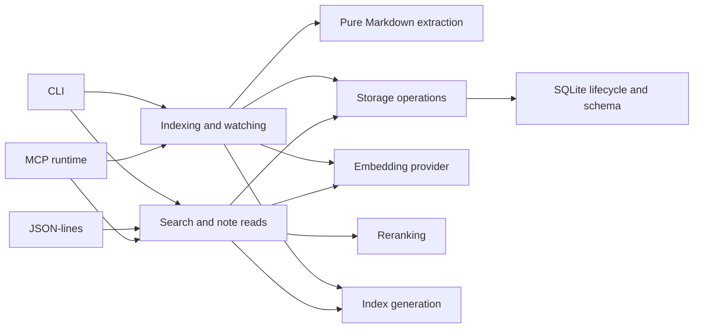

# Architecture

Obsidian Hybrid Search reads an Obsidian vault and exposes search, note reads, and
index management through a CLI, JSON-lines IPC, and MCP. Markdown files are the
source of truth. SQLite is a rebuildable index; a successful search never writes
to the user's notes.

## Ownership and dependency direction

Transports own argument validation, response formatting, startup, and shutdown.
They share the search and indexing behavior. [Boundary schemas](src/boundary-validation.ts)
validate external values before application code uses them; [configuration](src/config.ts)
owns environment settings. CLI discovery resolves a vault before opening its database.

[Search](src/searcher.ts) owns retrieval, result composition, note reads, and its
cache. [Indexing](src/indexer.ts) owns the work queue, watcher reconciliation,
embedding requests, and committing accepted changes. Neither acquires a raw SQL
handle. [Search storage](src/storage/search-queries.ts) and
[index storage](src/storage/index-queries.ts) own those queries and transactions.
[Database lifecycle](src/db.ts) owns connection initialization, schema migrations,
native extensions, and the persistence operations shared across callers. Storage
must not depend on transports or indexing orchestration.

[Note extraction](src/note-extractor.ts) transforms supplied Markdown into metadata
and link information. It does not read the vault, open a database, or invoke a
model. [Text normalization](src/text-normalization.ts) has the same independence.
[Index generation](src/index-state.ts) owns the in-process invalidation counter;
it lets indexing invalidate cached searches without importing the search service.

Embedding and reranking adapters own model loading and provider errors. They
receive text, not transport requests. Their model and device lifetimes are
process-scoped. Format parsing belongs before these adapters, rather than inside
a CLI command or database query.

## State and lifecycle

| State                                               | Owner and lifetime                                                    |
| --------------------------------------------------- | --------------------------------------------------------------------- |
| Notes, frontmatter, links                           | User's Markdown vault; durable input                                  |
| Searchable content, chunks, vectors, model identity | SQLite; derived, persisted per vault                                  |
| Queue, watcher, local index generation              | Indexing process                                                      |
| Cached search results                               | Search process; invalidated by local generation and database versions |
| Model sessions                                      | Embedding/reranking adapter; released with its process                |
| MCP process discovery and recovery records          | Runtime cache directory; never note content                           |

The database connection is a singleton within a process. Resolve an explicit vault
before opening it, and close its connection during shutdown. Tests must isolate
that binding. The shared unit runner deliberately resets modules before each file;
see [module isolation](test/setup-module-isolation.ts).

Indexing reads and extracts a note, obtains embeddings, then commits accepted
content with its metadata. Incremental updates and watcher events use the same
storage operations. The source Markdown and its character offsets remain aligned
when oversized chunks need recovery. Database triggers maintain the FTS content
tables; application code must not update those tables directly.

A model mismatch does not silently erase a healthy index or combine incompatible
vectors. Incremental work rejects incompatible producers. An explicit full force
rebuild probes the configured model before recreating the index. See the
[model compatibility tests](test/indexer-file.test.ts) and
[database integrity tests](test/db.test.ts).

Transport startup establishes the runtime and exposes readiness. Background
indexing can continue after MCP becomes available. Shutdown owns watchers, model
workers, transport connections, and the database. Native binary recovery remains
an installation concern, handled before runtime use; its failure reports the
installation log rather than presenting an empty search as success.

## Public contracts

Stored note paths use Unicode NFD. Filters operate on normalized paths and
metadata: tag and frontmatter includes are conjunctive, scope includes are
alternatives, and every exclusion removes matches. Results retain note identity,
source content, and link provenance across transports. Related search represents
source, outgoing links, and backlinks explicitly; semantic similarity excludes
the source note. Implementation details belong in [search tests](test/contract.test.ts)
and the search/storage modules, not a second specification here.

CLI JSON output, JSON-lines request IDs and errors, and MCP tool schemas are
compatibility surfaces. New search options must be routed through all three
boundaries. MCP parameter descriptions explain inputs, when to use the option,
and how overlapping modes are selected. The
[packaged process smoke](scripts/smoke-process.mjs) checks these contracts against
an installed release artifact and a temporary vault using real local embeddings.

An extraction or provider failure must remain observable. Indexing must not mark
failed work fresh or discard a valid prior index to hide a failure. A process
failure, cancellation, or missing evaluation output must fail verification.

## Extensions and enforcement

A future attachment feature should discover local attachments separately from
extracting their content. It needs explicit attachment identity, note ownership,
source locations, and compatible embedding spaces before it can join retrieval.
Markdown offsets cannot stand in for PDF pages or image regions. Those product
and storage decisions belong in the feature design; this architecture does not
introduce unused attachment interfaces.

[Dependency rules](dependency-cruiser.config.cjs) and
[architecture fixtures](test/architecture-boundaries.test.ts) enforce allowed
imports, raw storage access, and pure extraction boundaries. Tests include both
valid and rejected dependency graphs. ESLint checks typed imports, exhaustive
switches, promises, and project tooling. Knip starts from real entry points,
including the worker process, and checks entry exports. Its narrow exceptions are
host-loaded OpenCode/Pi exports and dynamic setup imports in filesystem fixtures;
the Pi host supplies its own API.

[The verification runner](scripts/verify.mjs) is the command source of truth for
local work, hooks, and CI. [CONTRIBUTING](CONTRIBUTING.md) describes the fast and
complete gates. The complete gate always evaluates the pinned corpus in both
modes and runs coverage once. No changed-path exemption or saved pass result
substitutes for a fresh run.
